<p align="center">
  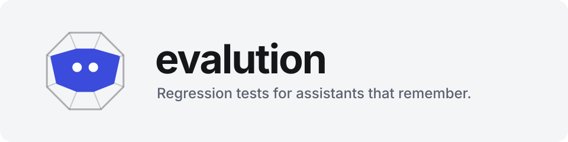
</p>

<p align="center">
  <b>Regression tests for assistants that remember, run locally, explained in plain words.</b>
</p>

<p align="center">
  <a href="#see-every-step">See every step</a> ·
  <a href="#quick-start">Quick start</a> ·
  <a href="#how-it-works">How it works</a> ·
  <a href="#writing-tests">Writing tests</a> ·
  <a href="#when-your-code-changes">Code changes</a> ·
  <a href="#keeping-what-it-knows-current">Keeping current</a> ·
  <a href="#connecting-your-agent">Connecting</a> ·
  <a href="#traces">Traces</a> ·
  <a href="#upgrading">Upgrading</a> ·
  <a href="#reference">Reference</a>
</p>

<p align="center">
  
</p>

<p align="center"><sub>Demo of the real app with a fictional shopping assistant and made-up data.</sub></p>

---

## An agent that tests your agent

Most eval platforms start from production traces on a hosted service. evalution works before release, on your machine: it plays real conversations against your own app, checks what was actually stored and what actually reached the model, and tells you in plain words how it went.

You describe what to test. An agent reads your code and traces, proposes the test, and explains the results.

| You say | It does |
|---|---|
| "Check that compaction keeps early decisions" | Reads your code and traces, proposes a test, and adds it when you approve |
| *press Run* | Plays real conversations in throwaway sessions and reads every step and model call |
| "How is my agent doing?" | Home says what's strong, what's weak and what needs you, without a chart to decode |
| "Why did this fail?" | Gives its reading of the cause in plain words, with evidence to check it against, and what to try |
| *you change the code* | Says which behaviour moved and which tests to run |

You stay in charge of what gets added and what runs: the agent proposes, you press the button.

### Built for the bugs that hurt

The worst bugs in an assistant don't show up in one answer to one prompt: a fact lost in compaction, a correction that doesn't stick, a withdrawn instruction still followed, a preference gone by the next conversation. A reply can read fine while the steps behind it are wrong, so evalution judges what your agent did as well as what it said.

## What you get

| | |
|---|---|
| **Works with your layout** | Give it a folder. It finds out how to talk to your app and watches your source, whatever the structure. |
| **An agent does the legwork** | Describe a test in a sentence. An agent reads your code and traces, proposes a plan, and adds it once you approve. Ask it about anything it finds. It never runs tests itself. |
| **Runs apart from real use** | Each run plays as a throwaway person, reset between tries. How clean that reset is depends on your adapter: see [Known limits](#known-limits). |
| **Judged on outcome; steps shown as a guide** | What's stored and what reached the model are checked by code, the reply by a model, with quotes as evidence. Tool calls and their order are shown beside them, and decide only when you say they should. A result that can't be judged says so and why. |
| **Built for stateful agents** | Ready-made tests for memory, compaction, corrections, forgetting and what carries across conversations. |
| **Knows when your code moved** | Home says which areas a change touched and which tests to run. Nothing runs until you press the button. |
| **Keeps what it knows current** | Each claim is linked to the files it rests on, and a commit marks the claims it touches. An update reads them against the code, automatically or when you ask; your corrections win and it can be undone. |
| **A health dashboard** | What's passing, how consistent it is, reply time and cost, with a report in plain words. |
| **No vendor required** | Runs locally, works with any model through a generic connection, and takes standard OpenTelemetry traces. |

## Quick start

You need Python 3.12+, [uv](https://docs.astral.sh/uv/) and Node.

```sh
./install.sh                                  # installs, builds the page, and checks what a first run needs
uv run --project server evalution serve       # or: evalution service install, to keep it running from login on
```

`evalution doctor` says what's missing and what to do about it, at any time and for free.

Open **http://127.0.0.1:8080**, then:

1. **Choose a model** under Settings: Claude, OpenAI or any OpenAI-compatible server, with a strong model for writing and grading and a cheap one for generated messages. *Test model* sends one tiny message to each.
2. **Type your app's address or project folder** and press Connect. evalution works out how to reach your app and shows any lines needed to send its traces.
3. **Send one test message** to see the reply and traces come back. If its settings misread your app, the model can correct them from what your app answered, and you choose whether to use them.
4. **Ask for a test** in the box, or pick a kind (exact answer, tool use, background work, memory, bad input, attack) or one the app suggests. **Variations** on a test offers new ones with other wording, another person asking, or a flawed input. You see its plan, time limit and anything this app can't serve before it's added.
5. **Press Run.** You see the estimated cost first.

There is no login: evalution only answers on the computer it runs on.

### With Docker

If you'd rather not install Python and Node, `compose.yaml` runs evalution alone, on 127.0.0.1:8080, with what it keeps in the same folders as above:

```sh
cp evalution.example.yaml evalution.yaml
mkdir -p data sets targets backups
docker compose up --build
```

Set `traces: {managed: builtin}` in `evalution.yaml`, since Phoenix isn't in the image. Your apps stay outside the container, so address one on this computer as `host.docker.internal`, and to connect a project by its folder, mount that folder in `compose.yaml`. Secrets go in a `.env` beside it, never in the file. On Linux, set `EVALUTION_UID` and `EVALUTION_GID` if you aren't user 1000.

It has no login. The port is published on 127.0.0.1, so other computers can't reach it, though any program on this one can. It answers only under the names in `EVALUTION_ALLOWED_HOSTS` (`localhost,127.0.0.1` in `compose.yaml`), so a web page can't reach it by pointing its own name here; an app in another container, or a proxy, needs its name added. Behind a proxy that puts in a `Host` of its own, add that name and the public one.

To upgrade or restore, stop the service first and run the command on its own, since a running `serve` holds the folders (`restore` refuses, even from `docker compose exec`):

```sh
docker compose stop evalution
docker compose build                                                     # to upgrade: the new code
docker compose run --rm evalution evalution upgrade                      # or: evalution restore /app/backups/<time>
docker compose up -d
```

## See every step

<sub>Screens from the real app, using the same fictional demo as above.</sub>

### 1. Point it at your project

Paste a folder. It works out how to talk to your app, checks it's running, finds your conversations, and starts learning.

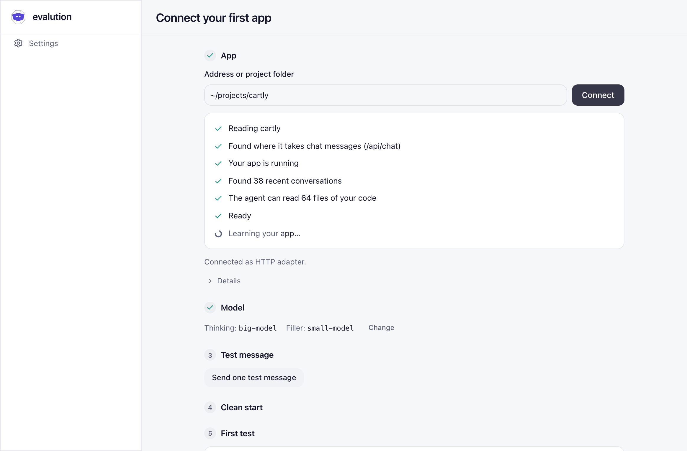

### 2. See what it learned

A project card and a map of how your agent works, each claim citing the file it came from. Correct anything wrong, and later tests follow.

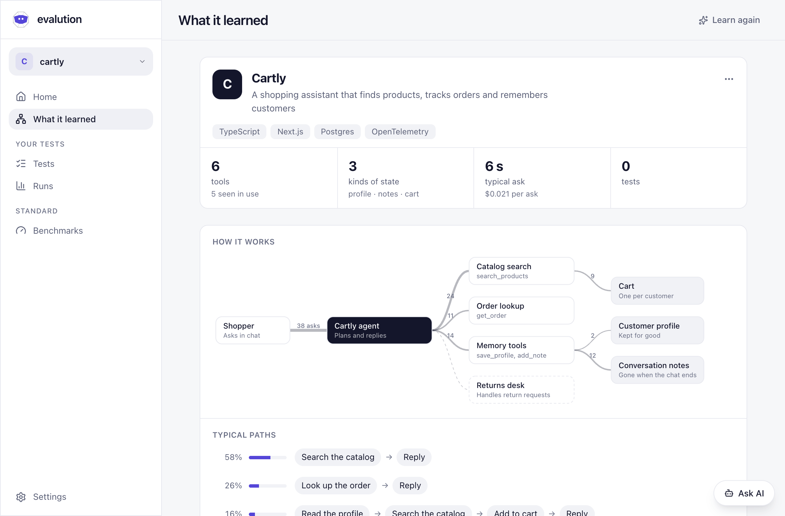

### 3. Say what to test

One sentence is enough. No datasets or scorers to wire up.

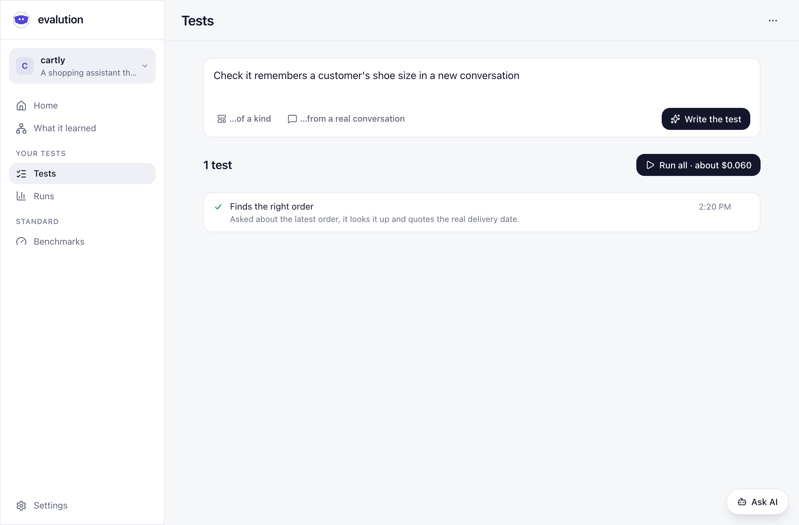

### 4. Approve the plan

Ask AI reads your code and traces, then proposes the test in plain steps. Nothing is added until you say so.

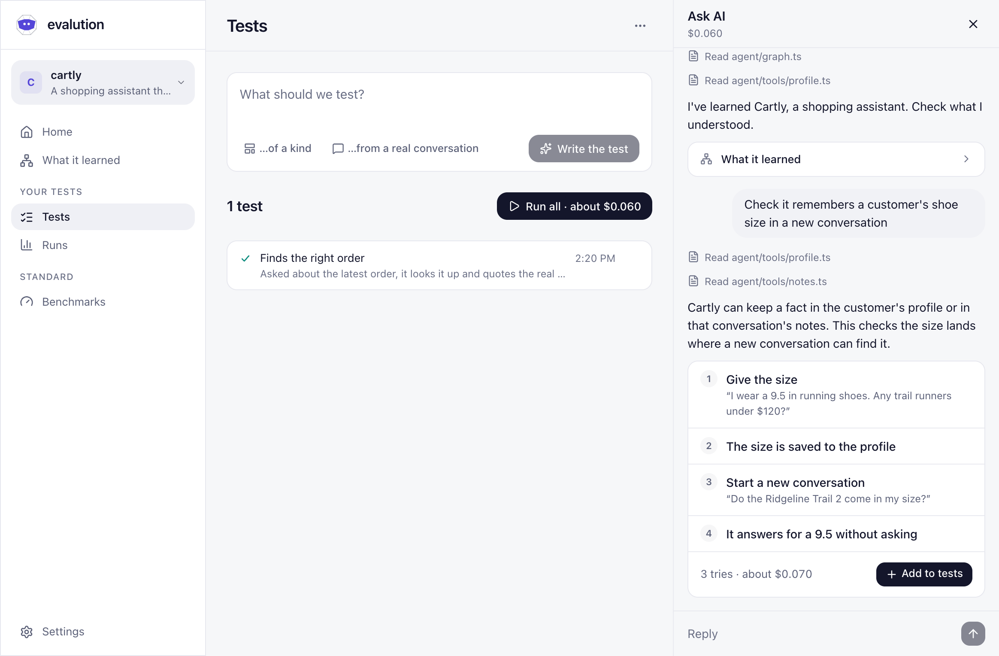

### 5. Read the test before it runs

Every step and what it checks, on one page.

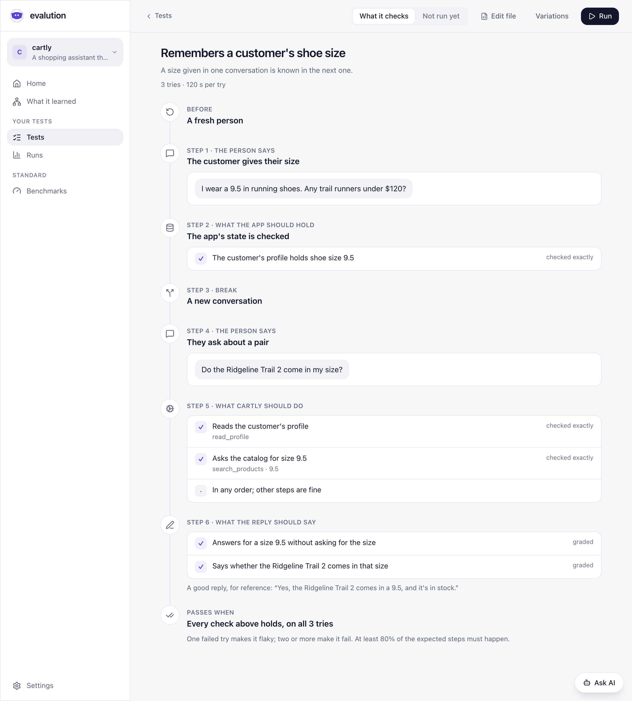

### 6. Press Run

You see the estimated cost first. Then it plays real conversations from a clean start.

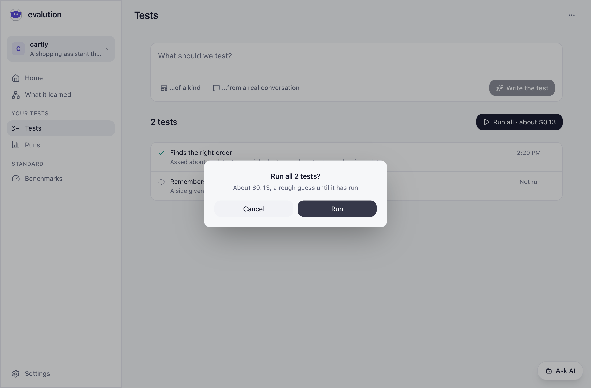

### 7. Get the answer

What went well, what went wrong and what to do next, with a link to the evidence. The numbers sit underneath.

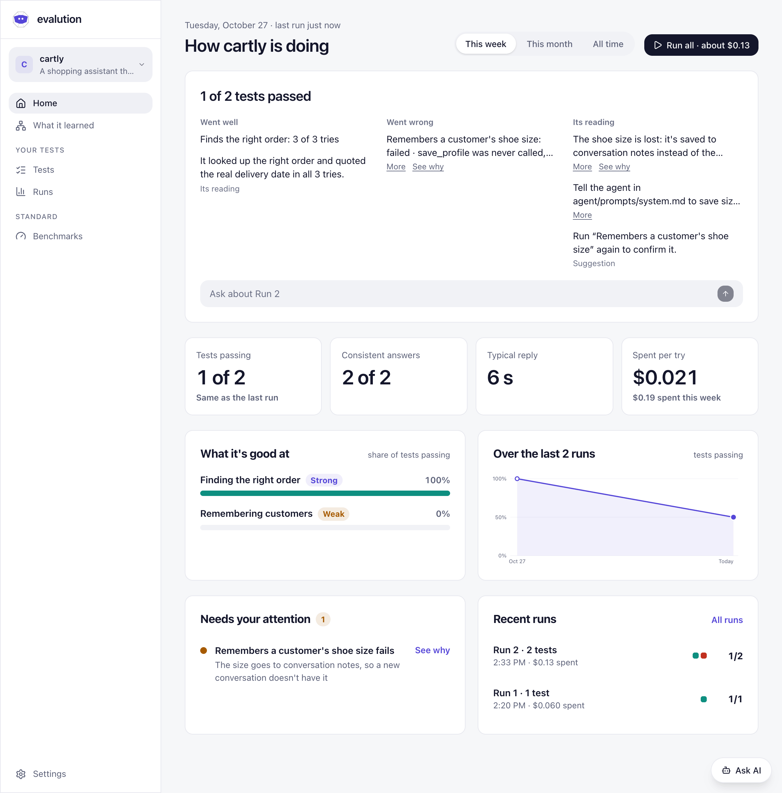

### 8. Change your code

It spots what moved and which tests to run again, and you decide when.

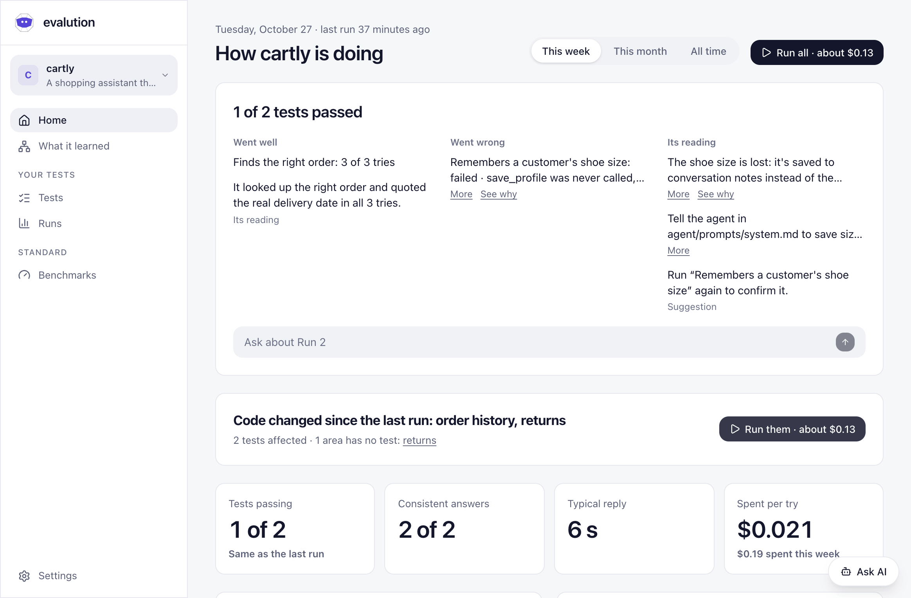

### 9. Ask about it

Ask a question in your own words, and Ask AI answers from the run.

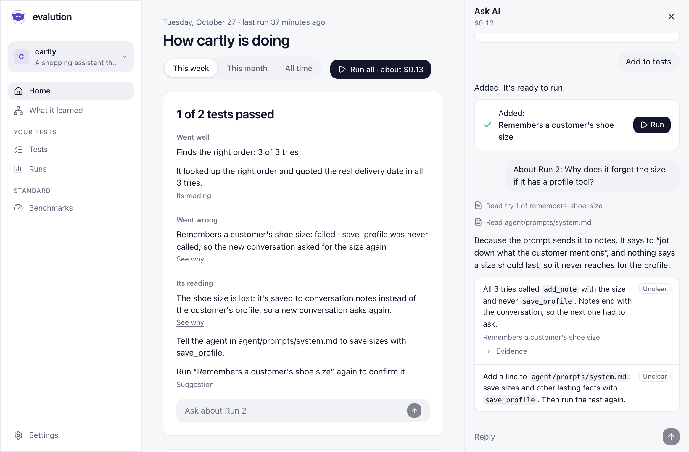

## How it works

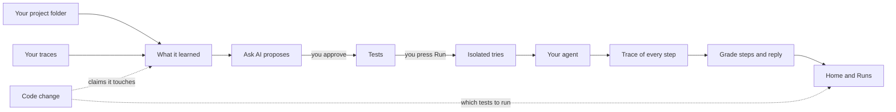

### The pages

| Page | What it's for |
|---|---|
| **A run** | Did this change make it worse? What changed in the setup, which tests moved, and whether a move could just be the agent varying. Against the last other setup, or any run you pick. |
| **Home** | How the agent is doing: what passed, trend, strengths and weak spots, what needs attention, recent runs. |
| **What it learned** | A project card, a diagram of how the agent works and its typical paths. Correct anything wrong and later tests follow. |
| **Tests** | Your tests, with a box to write a new one and one button to run them all. Open a test to see every expected step before it has ever run. |
| **Runs** | Past results grouped by test, with a plain reason when there's no verdict. |
| **Settings** | The model and connection details. |

### How a test is judged

An agent doesn't do the same thing twice, so evalution is careful about calling something broken. Each test runs several times from a clean start (three by default), and it judges the result first.

| Tries | Result | Meaning |
|---|---|---|
| All passed | **Passed** | It works, as far as this many tries can show |
| Some passed | **Flaky** | It can do it, but not reliably |
| None passed | **Failed** | It didn't get there on any try |
| None could be judged | **Couldn't judge** | Says nothing about your agent, so it's counted apart from passes and failures |

A pass that rests only on a model reading the reply says so: **Passed, judged by a model only**, counted apart from those a code check backed.

**Why it might not judge:** the app has no traces, traces didn't arrive or only part of them did, the traces don't hold what the model was sent, the grader failed or wasn't sure, the app couldn't be reached, was busy, refused the credentials or was blocked, the adapter misread it, or the app can't answer the check. None of these fail a try. An app error does, and so does a timeout with signs of the agent working. The plain rules are in [how a result is decided](docs/judging.md).

**What decides a try:** the reply's rubric lines (all of them, or the number the test sets with `pass`), exact words the reply must or must not have, what a tool must return, anything it must never do, what's stored, and finishing in time. A test with only a reference answer and no rubric uses a score of at least 0.7 instead. Only a line the grader isn't sure of is graded again, by a prompt looking for why it doesn't hold; unsure twice is *Couldn't judge*.

**Steps are a guide.** If your agent gets a good result by another route, the test passes and says *different route*, so you can decide if that matters. When the path itself is the point, set `"strict": true` on the test's `tools`, and its steps must score at least 0.8.

## Writing tests

Usually you just describe it to Ask AI. Tests are plain JSON in `sets/<app>/<set>/`, made for code review:

```json
{
  "name": "CSV total computed, not eyeballed",
  "turns": [
    {
      "message": "What's the total amount for the North region in this file?",
      "files": ["fixtures/orders.csv"],
      "fresh": true
    }
  ],
  "tools": { "order": "any_order", "never": ["hand_off"] },
  "reply": {
    "reference": "Gives the North total as exactly 4,828.13, worked out by code run on the file.",
    "rubric": [
      "States the North total as 4,828.13 (exact, not rounded)",
      "The tool calls show the total was computed by code run on the file",
      "Names no tool, file path or Helper"
    ]
  },
  "limits": { "tries": 3, "seconds": 120 }
}
```

A conversation can be more than one message:

| Turn | What it does |
|---|---|
| `{"message": "...", "files": [...]}` | The person says something, with optional attachments |
| `{"fresh": true}` on a message | Asks the adapter to start this try with nothing from an earlier one |
| `{"filler": 20, "about": "..."}` | Generates a long conversation, to force compaction |
| `{"expect_state": {...}}` | Checks what's true at this moment, like what the call answering the next message is sent (`context_contains`, `context_lacks`) or what's stored (`memory_contains`, `memory_lacks`, `checkpoint`) |
| `{"break": "conversation"}` | Starts a new conversation as the same person |

Tool order can be `exact`, `in_order` or `any_order`; expected tools can check arguments, counts and parallel calls. Tools in `never` always count against a try, while `expected` is a guide unless the test sets `strict`, asks for `exact` order, disallows extras, or has no reply to judge.

**The stateful library** in `library/stateful/` holds ready-made tests, which Ask AI adapts to your app: fact recall, corrections, withdrawn instructions, forgetting on request, compaction keeping an early decision, compaction dropping a withdrawn fact, recall from the right conversation, preferences and tasks across conversations, and long chats keeping a name and role.

## When your code changes

evalution watches every source file, from git or a folder walk, and needs no list of paths. Tests, lockfiles, build output, binaries, files over 1 MB and secret files are skipped.

When code differs from what was last tested and the app's updates are set to *Automatically* (see [below](#keeping-what-it-knows-current)), one call to the cheap model reads the diff against what it learned about your app, and Home shows:

> **Code changed since the last run: conversation compaction, context checkpoint**
> 2 areas have no test: conversation compaction, context checkpoint

- **Affected tests** get a *Run them* button. Nothing runs by itself.
- **Areas with no test** link to Ask AI, with the ask ready for you to send.
- **Regressions** name the commits: *"Memory recall passed on abc1234, fails on def5678"*.
- **A change that can't affect behaviour** shows no card, but it isn't forgotten: it's read again with the next change until a run covers it.
- **Set to *When I ask*** (the default), the card shows the changed files and all the tests, with no model call, and *Read this change* asks for the reading, with its rough cost on the button.

The check runs when you view Home (at most every five minutes), before each run, and once a day. To trigger it from CI, or with the [hooks](#keeping-what-it-knows-current):

```sh
curl -X POST http://127.0.0.1:8080/v1/targets/<app>/changed
```

It answers at once and the check follows in the background, a burst of calls counting as one.

Traces are compared too: new or removed tools, changed arguments, a changed system prompt, or a shift in the usual path. A test that names something changed is marked stale.

## Keeping what it knows current

*What it learned* goes stale as the code moves, so each claim and box in it is linked to the files its evidence cites, with each file's hash. Links are made with no model call, including for what was learned before this existed. A claim that rests only on traces or on you has no file links, and code never marks it.

**How a change reaches a claim.** A new commit is compared with the commit last checked; uncommitted edits only show on the change card.

- **Directly:** a file the claim cites changed.
- **Through imports:** a file the claim cites imports a changed one, within two steps. This is weaker: most such changes don't matter, so only the model can decide it does, and it must cite the changed file to rewrite the claim. It never removes one this way.

**Choose when it updates**, per app, under Settings, *Update what it knows*:

| Setting | What happens on a commit | What spends |
|---|---|---|
| **When I ask** (default) | Claims are marked. *What it learned* and Home say how many may be out of date, next to *Update · about $0.002* | Only pressing the button, and *Read this change* on the change card |
| **Automatically** | Claims are marked, then updated | One call to the cheap model per distinct committed change, and the existing one for the change card |

The default is *When I ask* because the other one spends without a click. Finding and marking changes never costs anything. Costs on the buttons are rough, worked out from the size of the diff and the cheap model's price. Turning *Automatically* on spends nothing by itself: what is already marked stays behind the button, and the next commit is the first one read.

**What an update does.** One model call gets the marked claims, the diff and the text of the files they cite (secret files never), and answers per claim: still true, rewritten with a new citation, or gone. It may add up to three claims when the diff clearly adds behaviour. A rewrite that cites no real file is dropped and that claim stays marked. A failed call changes nothing and leaves everything marked; in *Automatically* it's tried again on the next commit or after a day.

- **Your corrections win.** A claim you fixed or marked right or wrong is never rewritten. It shows *May be out of date*, for you to look at again.
- **It can be undone.** An update is a new version: *What changed* shows the difference and *Undo* puts back the one before.
- **Tests** that name a changed tool or argument are still marked stale the same way as before.

**Hooks are opt-in.** Nothing installs them unless you run the command or tick *Git hooks* in Settings:

```sh
uv run --project server evalution hooks install --target my-bot   # also: uninstall, status
```

They go in the repo's real hooks folder (`core.hooksPath` and worktrees honoured) as `post-commit`, `post-merge`, `post-rewrite` and `post-checkout`. They chain: a marked block is added to a shell hook you already have and the rest is left alone, and uninstall takes out only that block. A hook that is a link, not a shell script or switched off is left alone and reported, and a hooks folder that is part of the repo or shared with other repos is refused. The block is a backgrounded `curl` with short timeouts and its output discarded, so a git command is never slowed or failed. Without hooks the same check happens when you view Home and once a day. A folder that isn't a git checkout has links but no commits, so hooks and updates aren't available there.

**Limit:** import tracing is best-effort by language. Python, JavaScript, TypeScript, Go and Markdown links are read; path aliases and dynamic imports can be missed, a same-named module can be linked wrongly, and other languages have no import links, only direct ones.

## Connecting your agent

Connecting by folder picks the adapter for you, and the page says which. An address gets the `http` adapter. Changing the adapter changes what is tested, so the page says so and the test message has to pass again.

| Adapter | For | What it can do |
|---|---|---|
| `http` | Any app with a chat endpoint | Sends messages and reads replies; steps come from traces |
| `langgraph` | Graphs on `langgraph dev`, `up` or Platform | Reads `langgraph.json`; fresh user per run; checks memory, summaries, trimming and thread state |
| Your own | Anything else | See below |

[`examples/langgraph-memory-agent`](examples/langgraph-memory-agent) is a tiny graph to try.

**Most apps need no code.** The HTTP adapter can have the app make its own session (`open`), wait on a status route (`done.poll`), read a reply nested in a list (`$.items[?data.role=='assistant'][-1].data.content`), and wait out work that continues after a first answer (`background: true`). A proxy in your environment is used for the outside world and never for this machine.

Set `automatic_tools: [name]` on a target for tools the app calls by itself. They stay in the evidence, aren't scored, and show as automatic on the test page. `evalution check --target <name> --isolation` tests whether a new session really starts clean.

**Your own adapter:** one module in `data/adapters/<name>.py` (or wherever `adapters_dir` says), with no edit to evalution. That folder isn't tracked, so an adapter for a private app stays private. Only the config points at this folder: connecting a project never runs code from it.

```sh
uv run --project server evalution adapter new my_app                  # a commented starter, never over a file that's there
uv run --project server evalution adapter test my_app --target my-app # its contract over the real app: says what it spends, asks first
```

The test checks the adapter and not your agent: sessions are unique, a turn ends with a reply, the deadline holds, `close` works, whatever it declares really works, and its sessions find their traces. What to write, and what each built-in adapter promises, is in [writing an adapter](docs/adapters.md).

## Traces

Steps, context and cost come from traces. All reading goes through one interface, so you choose where they live:

| Option | Set with | Good for |
|---|---|---|
| **evalution's own Phoenix** (default) | `traces: {managed: true}` | A full trace UI, run for you on port 6007 |
| **Your app's Phoenix** | `traces: {managed: false}`, plus `phoenix:` on the target | You already run Phoenix |
| **Built in, no Phoenix** | `traces: {managed: builtin}` | Nothing extra to install: apps send OTLP to `/v1/traces`, kept in a capped SQLite file |

Both the OpenInference and OpenTelemetry GenAI conventions are understood, and plain HTTP and framework spans are left out of the timeline. For a built-in source, name the app with the resource attribute `evalution.target`, and put each conversation's id on its spans as `session.id` or `gen_ai.conversation.id`.

## Cost and privacy

**Cost.** Every try is a full chat, paid for by you. You see an estimate before each run, based on that test's own recent tries. A test that has never run gets a rough guess, marked as one. Nothing stops a run partway because of cost, so try an expensive-looking test with one try first. Ask AI has its own budget per session, shown in its panel.

**What stays local.** Results, tests and settings all live on your machine. There's no hosted service and no login. Each run also keeps what it saw in `data/runs/<run>.evidence.jsonl.gz`: prompts your app sent, tool arguments and outputs, in full up to 64 KB an item. That file is owner-only and git-ignored, and sits beside the run until you delete it.

**What goes to your model.** The model you configure sees code Ask AI reads, diffs of changes, traces and replies. Secret files are never read, but they're recognised by file name: a key pasted into a normal source file could be sent in a diff.

**Secrets.** They stay in `data/secrets.json` (owner-only), or in environment variables you name. They are never returned by the API, logged or sent to the model.

## On pull requests

Keep a run you're happy with, then fail a pull request only when something gets worse than it:

```sh
uv run --project server evalution run --target my-bot --set main --save .evalution/baseline.json
```

```yaml
- uses: jcodebreaker/evalution@main
  with:
    target: my-bot
    baseline: .evalution/baseline.json
  env:
    EVALUTION_MODEL_KEY: ${{ secrets.EVALUTION_MODEL_KEY }}
```

Your app has to be running where the job can reach it. A baseline holds the replies from that run, so read it before committing it. The Action hasn't been run on GitHub yet.

## Upgrading

```sh
git pull
./install.sh                                  # new dependencies and a new page; evalution.yaml, data/, sets/ and targets/ stay as they are
uv run --project server evalution upgrade     # with Docker, see "With Docker": stop the service, then docker compose run
```

`install.sh` is safe to run again: it pulls nothing and never overwrites `evalution.yaml`. Old runs read fine without the last step, which only rewrites them for good.

`evalution upgrade` first copies `data/`, `sets/`, `targets/` and your settings to `backups/<time>/`. Then it rewrites stored runs as today's shape, keeping each original beside it as `.bak`, says which it changed, checks every run still reads and says what it said, and prints the exact command that undoes it all. It refuses while a run is going, and exits non-zero if anything didn't check out.

- `evalution backup` makes the same copy on its own. It holds your secrets and is owner-only: treat it as you would `data/secrets.json`, and delete what you no longer need, since nothing does that for you.
- `evalution restore <backup>` puts one back, whole, after checking it isn't damaged and backing up what's there now. It refuses while `serve` runs on this data folder, and a backup kept inside `data/`, `sets/` or `targets/`: move that out first.

## Reference

### Commands

```sh
uv run --project server evalution serve                         # the page and API on :8080
uv run --project server evalution run --target my-bot --set main  # prints the estimate, asks first
uv run --project server evalution profile --target my-bot       # digest of recent traces
uv run --project server evalution hooks status --target my-bot  # git hooks: install, uninstall, status
uv run --project server evalution migrate                       # rewrite stored runs as today's shape, keeping a .bak
uv run --project server evalution compare latest --target my-bot --set main  # did this change make it worse? 1 when a test did
uv run --project server evalution check --target my-bot           # one real turn, to show the adapter works
uv run --project server evalution regrade <run> --rules         # today's rules over its checks: free, offline
uv run --project server evalution regrade <run> --judge         # grade its replies again from its evidence: spends, asks first
uv run --project server evalution upgrade                       # back up, rewrite stored runs, check they all still read
uv run --project server evalution backup                        # the same copy alone; restore <backup> puts one back
uv run --project server evalution adapter test my_app --target my-bot  # an adapter's contract: spends a few messages, asks first
uv run --project server evalution adapter new my_app            # a starter for your own adapter
```

`--config <file>` goes before the command. `serve --host <address>` opens evalution to other computers **with no login**, and warns you. It answers under that address (on `0.0.0.0`, under this computer's own names) and the names you add with `EVALUTION_ALLOWED_HOSTS` or `allowed_hosts` in the config. A plain `serve` takes the same names, for a proxy on this computer. `docker compose up` runs evalution alone: see [With Docker](#with-docker).

### Where things live

| Path | Holds | In git? |
|---|---|---|
| `sets/<app>/<set>/` | Your tests and fixtures | Not in this repo: set `sets_dir` to a folder in your own |
| `library/` | Ready-made tests | Yes |
| `targets/<app>/` | What it learned, fingerprints, change state | Your choice |
| `data/runs/<run>.json` | Run results, one file each | No |
| `data/runs/<run>.evidence.jsonl.gz` | What each try saw, owner-only | No |
| `data/phoenix/`, `data/traces/` | Traces | No |
| `data/secrets.json` | Secrets | No |
| `evalution.yaml`, `targets.yaml`, `model.yaml` | Settings; with Docker the last two are in `data/settings/` | No |
| `backups/<time>/` | Copies from `backup` and `upgrade`, secrets included, owner-only | No |

Most people never edit settings by hand. To do so, copy [`evalution.example.yaml`](evalution.example.yaml) to `evalution.yaml`. A `model:` there wins over the page, and `EVALUTION_MODEL_KEY` wins over a stored key.

### Known limits

These are the things to keep in mind when reading a result. Most are on the list to fix.

- **A verdict is often a model's judgement.** Unless a test checks stored state or what reached the model, the result is a model reading the reply and what the app did, within a budget that visibly cuts long tool output. Such a pass is labelled. Graders can be wrong, and evalution doesn't yet measure how often. They can use their own model (`judge` in the config), and otherwise use the strong one that also writes tests.
- **Reports can be wrong.** What passed and failed comes from the checks. The causes are a model's reading, marked as its own: code checks that what it cites exists and what it quotes occurs, not that it read them right. Check the evidence before acting on one.
- **A pass can rest on what an earlier try left behind.** Nothing reads an app's state before a try starts, so a reset that leaves memory behind can hide a write that never happened.
- **A check can't see past its adapter.** One that reads the wrong place without knowing it reports what it found. With traces, evalution catches an empty reply or a wait for an answer already given; without them, only the deadline and the one-turn check before a first run can. And a turn that calls no AI at all, or clocks over a second apart, reads as partial traces: a false *Couldn't judge*, not a false result.
- **Isolation depends on the adapter.** The HTTP adapter only starts a new session id, so what carries over depends on your app. LangGraph clears its store namespace, not memory kept elsewhere. `fresh` is passed to the adapter and isn't verified.
- **The library tests are new.** The four with a check the code decides catch their seeded bug; the other six rest on a model's verdict, and how often that catches one isn't measured.
- **The pipeline is exercised on a scripted agent, not yet proven on a real one.** See [what that shows](docs/proof.md).
- Three tries spot flakiness; they don't measure a rare failure. Raise `tries` (up to 20) for what matters most.
- Import tracing is best-effort by language, and one update sends at most 60 claims; the rest stay marked for the next press.
- Watching stops at 2,000 files, in path order, so a very large monorepo is partly covered.
- Results are local files, so a team can't share history yet, and pages slow down at thousands of runs.
- The built-in trace source hasn't been tested with an app running in Docker.
- The Docker setup is checked by reading it, and hasn't been built or run by the tests or CI.

### Development

```sh
cd server && uv run --all-groups ruff format --check . && uv run --all-groups ruff check . && uv run --all-groups lint-imports && uv run --all-groups pytest    # server
cd web && npx tsc --noEmit -p . && npm run build   # page
```

CI (`.github/workflows/ci.yml`) runs these on every push and pull request, and audits the dependencies of both.

Design and behaviour: [architecture](docs/architecture.md) · [case format](docs/case-format.md) · [how often the judge is right](docs/accuracy.md) · decisions: [own project](docs/adr/0001-evals-are-their-own-project.md), [stateful first](docs/adr/0002-lead-with-stateful-assistants.md), [watch everything](docs/adr/0003-watch-everything-interpret-with-the-model.md), [traces behind one interface](docs/adr/0004-traces-behind-one-interface.md), [keeping what it knows current](docs/adr/0005-keep-what-it-knows-current.md), [package layout](docs/adr/0006-package-layout.md), [the judgement model](docs/adr/0007-the-judgement-model.md) · [how a result is decided](docs/judging.md) · [writing an adapter](docs/adapters.md).

### Licence

Private, with no licence granted yet. The optional managed trace store is Arize Phoenix under the Elastic License 2.0, installed only with the `traces` group; see [NOTICE](NOTICE). The built-in source doesn't use it.
